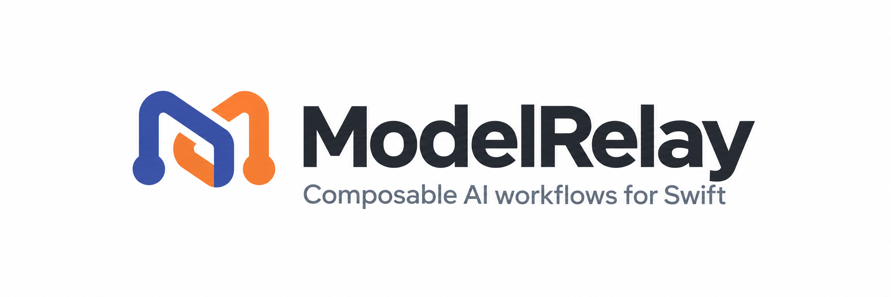
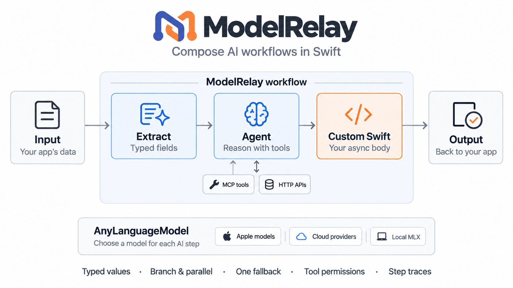
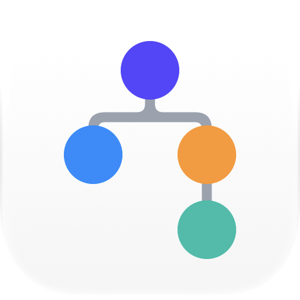

<p align="center">
  <a href="#installation"></a>
  <a href="#installation"></a>
  <a href="#installation"></a>
  <a href="#license"></a>
</p>

# ModelRelay

**Small steps. Different models. One workflow.**

An AI feature often needs more than one prompt. Read a receipt, extract its
fields, check the numbers, ask a tool, then let the user review the result.

ModelRelay helps you connect those steps in Swift. Choose a model for each
task, pass typed results between them, and keep control over tools,
permissions and execution.

Built on [AnyLanguageModel](https://github.com/huggingface/AnyLanguageModel)
for inference and conversations. ModelRelay adds the workflow around them.
Your app brings the interface, data and storage.

Let's build something 🙂

<p align="center">
  <a href="#features">🌟 Features</a> ·
  <a href="#why-modelrelay">🤔 Why ModelRelay?</a> ·
  <a href="#installation">📲 Installation</a> ·
  <a href="#usage">🐒 Usage</a> ·
  <a href="#models">🧠 Models</a> ·
  <a href="#use-cases">💡 Use cases</a> ·
  <a href="#advanced">🛠 Advanced</a> ·
  <a href="#guides">📚 Guides</a> ·
  <a href="#runline">📱 Runline app</a> ·
  <a href="#contributing">❤️ Contributing</a>
</p>

<a name="features"></a>

## 🌟 Features

- 🧩 **Compose in Swift:** small steps, result builders, branches and parallel work.
- 🧠 **Choose models per step:** Apple models, cloud providers, OpenAI-compatible servers and opt-in local MLX.
- 🤝 **Connect agents:** share a native conversation or hand selected results to another model.
- 🧰 **Bring your tools:** HTTP APIs, MCP tools and reusable tool kits.
- 🎯 **Ask typed questions:** extract fields, classify text or use decision models such as Jev.
- 👨‍💻 **Add your own logic:** async Swift bodies, without a script runner.
- 🔒 **Set boundaries:** write approval, local-only data policies and execution budgets.
- ⏸ **Review and resume:** checkpoint contracts, approval gates, step records and metadata-only events.



<a name="why-modelrelay"></a>

## 🤔 Why not just use Apple's APIs?

You can! Foundation Models already provides [stateful sessions and streaming](https://developer.apple.com/documentation/foundationmodels/languagemodelsession),
[structured generation](https://developer.apple.com/documentation/foundationmodels/generating-swift-data-structures-with-guided-generation)
and [tool calling](https://developer.apple.com/documentation/foundationmodels/expanding-generation-with-tool-calling).
For a prompt, an extraction or a conversation with Apple's model, using it
directly is often the simplest choice.

ModelRelay is for the process around those calls:

| You need… | With Apple APIs directly | ModelRelay adds |
| --- | --- | --- |
| 🧩 Multiple steps | Connect calls with Swift concurrency and your own state | Named results, branches and parallel blocks in one `Workflow` |
| 🧠 Different models | Integrate providers and choose when to call each | Per-step catalog IDs and one explicit fallback, using AnyLanguageModel providers |
| 🤝 Shared context | Keep sessions and pass selected results yourself | Named conversations and explicit handoffs between agents |
| 🧰 External tools | Implement `Tool` types and service integrations | Reusable kits, HTTP/MCP integrations and write approval |
| 🔒 Execution rules | Add application-level checks and counters | Preflight validation, privacy labels and workflow-wide attempt/concurrency limits |
| ⏸ Review and recovery | Persist transcripts plus your own job state | Approval gates and `start` / `resume` checkpoints with a host-owned store |
| 📡 Progress | Stream generated content and inspect session history | Workflow events, step records and a final execution report |

Apple also supports [custom model providers](https://developer.apple.com/documentation/foundationmodels/languagemodel)
on OS 27+. ModelRelay's value is reusable **workflow orchestration**, not
exclusive access to tools, structured output or other models.

**Support apps from iOS 18.** ModelRelay's workflows, remote models, tools,
MCP and checkpoints work on iOS 18 and later. Apple's model features still
require their supported OS and hardware. [Platform requirements →](#installation)

You could build this coordination yourself. ModelRelay packages it without
replacing the native inference runtime. It does not make Apple's model
faster or remove its hardware, availability or entitlement requirements.
Workflow events are not token streaming, and recovery still needs your
durable storage. [Execution boundaries →](Documentation/ExecutionSafety.md) ·
[Recovery contract →](Documentation/Recovery.md)

<a name="installation"></a>

## 📲 Installation

Build with **Xcode 27 / Swift 6.4**. Your app can target **iOS 18+,
macOS 15+ or visionOS 2+**. This package currently targets Apple platforms, not Linux.

| Capability | Minimum OS |
| --- | --- |
| Workflows, remote models, tools, MCP and checkpoints | iOS 18 / macOS 15 / visionOS 2 |
| Apple's on-device text model and tools | iOS 26 / macOS 26 / visionOS 26 |
| Apple model image input and Private Cloud Compute | iOS 27 / macOS 27 / visionOS 27 |

Apple models also need compatible hardware and model availability.
Private Cloud Compute requires its entitlement. Use another registered
provider on older systems, or configure an explicit fallback.

Add ModelRelay with Swift Package Manager:

```swift
// swift-tools-version: 6.4
import PackageDescription

let package = Package(
    name: "MyClient",
    platforms: [.macOS(.v15), .iOS(.v18), .visionOS(.v2)],
    dependencies: [
        .package(url: "https://github.com/Juanpe/ModelRelay.git", "0.1.0" ..< "0.2.0", traits: []),
    ],
    targets: [
        .target(name: "MyClient", dependencies: [
            .product(name: "ModelRelay", package: "ModelRelay"),
        ]),
    ]
)
```

Releases follow [Semantic Versioning](https://semver.org/spec/v2.0.0.html).
During `0.x`, patch updates stay compatible; breaking changes require a new
minor version. The range above accepts `0.1.x`, not `0.2.0`.
[Changelog →](CHANGELOG.md) · [Version policy and publishing →](Documentation/Releasing.md)

<details>
<summary>📦 Which products do I need?</summary>

One package, separately importable products. Start with the core and add
integrations when you need them:

| Product | What it adds |
| --- | --- |
| `ModelRelay` | Workflows, typed values, builders, execution and custom Swift bodies |
| `ModelRelayHTTP` | HTTP request steps and HTTP agent tools through URLSession |
| `ModelRelayCloud` | Specialized decision models, including Jev |
| `ModelRelayMCP` | MCP tools over Streamable HTTP and optional OAuth helpers |
| `ModelRelayMLX` | Convenience presets for native MLX providers |

For ordinary cloud generation, register AnyLanguageModel's providers directly.
`ModelRelayCloud` is for specialized decisions, not a required cloud adapter.
Apple's on-device model, Private Cloud Compute and text recognition are built
in; register other providers in your `ModelCatalog`.

ModelRelay has one direct third-party package dependency: AnyLanguageModel.
Selecting fewer products avoids building unused targets, but SwiftPM may
still resolve optional transitive dependencies.

**Using MLX?** Add the `ModelRelayMLX` product and change `traits: []` to
`traits: ["MLX"]`. It is disabled by default and also needs Xcode's Metal
Toolchain (`xcodebuild -downloadComponent MetalToolchain`).

</details>

<a name="usage"></a>

## 🐒 Usage

Start with three steps:

### 1️⃣ Import

```swift
import ModelRelay
```

### 2️⃣ Describe your workflow

Let's turn a receipt into typed fields:

```swift
let workflow = Workflow(
    name: "Receipt to expense"
) {
    Step.extract("expense", instruction: "Extract the expense from this receipt.", model: .appleOnDevice) {
        Field("merchant", .text)
        Field("total", .number)
        Field("currency", .choice(["EUR", "USD", "GBP"]))
    }
}
```

`name` is the workflow's display name. Step names identify results that
later steps can reference.

### 3️⃣ Run it

```swift
let report = try await WorkflowExecutor().run(
    workflow,
    input: .text("BLUE BOTTLE COFFEE · TOTAL EUR 8.30")
)

print(report.output["total"]?.textValue ?? "") // e.g. 8.3
```

That's it! Your app receives a `Value`, not a string it has to parse by hand.

> 💡 This example uses Apple's on-device model, which must be available on
> your device. Other models and fallbacks need to be registered in a
> `ModelCatalog` first.

See [models and setup](#models) for Jev, Ollama and other providers.

**Want to try it without a model or API key?** The
[standalone example](Examples/StandaloneClient) runs a deterministic workflow:

```sh
swift run --package-path Examples/StandaloneClient StandaloneClient
```

### 🧩 The main pieces

| You want to… | Start here |
| --- | --- |
| Describe the process | `Workflow`, `Step`, `Field` |
| Pass data in and get it back | `Value`, `WorkflowExecutionReport` |
| Choose model implementations | `ModelCatalog` |
| Execute a workflow | `WorkflowExecutor.run` |
| Save progress and wait for review | `start` / `resume`, `WorkflowExecutionCheckpointStore` |

By default, each step reads the previous result. Select an earlier result
with `input: "expense"`, or insert one into text with `{{expense.total}}`.
See the [usage recipes](Documentation/Usage.md) for all step types and data-flow rules.

<a name="models"></a>

## 🧠 Pick your models

Use Jev to make a decision, Ollama to summarize, and another model to draft
the reply. Each step chooses a registered model ID; the workflow stays the same.

| Want to use… | Register… | Example |
| --- | --- | --- |
| 🗳 **Jev** | `CloudModels.jev` + `DecisionsAPIModel` from `ModelRelayCloud` | [Route and score a ticket](Documentation/Models.md#jev) |
| 🦙 **Ollama** | Native `OllamaLanguageModel` | [Summarize with Qwen](Documentation/Models.md#ollama) |
| ☁️ **OpenAI / Anthropic** | Native `OpenResponsesLanguageModel` / `AnthropicLanguageModel` | [Cloud providers](Documentation/Models.md#cloud) |
| 🔌 **OpenAI-compatible servers** | Native `OpenAILanguageModel` with your base URL | [Bring an endpoint](Documentation/Models.md#compatible-servers) |
| 🍎 **Apple models / OCR** | Built in: `.appleOnDevice`, `.applePrivateCloud`, `.appleTextRecognition` | [Use Apple's models](Documentation/Models.md#apple) |
| ⚡️ **On-device MLX** | `ModelRelayMLX` presets with the `MLX` trait | [Run Qwen in-process](Documentation/Models.md#mlx) |

Jev answers typed questions; it is not a text generator. Ollama serves a
model over HTTP; MLX runs it inside your process. Native providers come from
AnyLanguageModel, without another ModelRelay adapter.

[Setup and examples →](Documentation/Models.md) ·
[Mix Jev and Ollama in one workflow →](Documentation/Models.md#mix-models)

<a name="use-cases"></a>

## 💡 What can you build?

Your users don't need a workflow editor. You define the process; they use
the feature inside your app.

| Feature | A possible workflow |
| --- | --- |
| 📬 **A support inbox** | Extract the request → classify urgency → look up an order with tools → hand context to a reply agent → review before sending |
| 🧾 **An expense assistant** | Read a receipt image → extract totals → classify the expense → validate with Swift → review before submitting |

Use a small model for triage, a different one for drafting, and your own
Swift code for business rules. ModelRelay connects them; your app owns
capture, review, credentials and storage.

<a name="advanced"></a>

## 🛠 A little further

### 🔀 Do independent work in parallel

Summarize an article and classify its tone, then combine both results:

```swift
let workflow = Workflow(
    name: "Analyze article",
    output: "result"
) {
    Step.parallel("analysis") {
        Step.prompt("summary", "Summarize in three bullet points.", model: .appleOnDevice)
        Step.classify("tone", "Identify the tone.",
                      labels: ["positive", "neutral", "negative"], model: .appleOnDevice)
    }
    Step.template("result", "{{summary}} · Tone: {{analysis.tone}}")
}
```

`output: "result"` returns the value of the step named `result`.

Parallel children read the same incoming data, not each other's results.
Use `ifEquals` or `switchOn` when the result should choose a path.
[Composition recipes →](Documentation/Usage.md#composition)

### 🤝 Keep the conversation going

Give two steps the same conversation name and model to reuse their native
session within one execution:

```swift
let workflow = Workflow(
    name: "Draft and review"
) {
    Step.agent("draft", "Write a short answer.", model: .appleOnDevice)
        .withContext(.conversation("writer"))
    Step.agent("review", "Review your previous answer.", input: "input", model: .appleOnDevice)
        .withContext(.conversation("writer"))
}
```

Switching models? Use `.withContext(.handoff(["review"]))` to give a fresh
session selected results. Conversations are isolated between executions;
a different model or fallback has its own history.
[Context and resource lifetimes →](Documentation/ContextAndPolicies.md)

### 👨‍💻 Add a step that is just Swift

No model needed for trimming text, validating totals or applying your app's rules:

```swift
import Foundation

let workflow = Workflow(
    name: "Normalize text"
) {
    Step.custom("normalized") { context in
        .text(context.input.textValue.trimmingCharacters(in: .whitespacesAndNewlines))
    }
}
```

> ⚠️ Custom bodies are trusted, compiled host code, not a sandbox for model
> output. They make the workflow definition non-serializable; execution
> checkpoints are separate data.
> [Custom-step boundaries →](Documentation/Usage.md#custom-swift)

### 🔒 Keep execution under control

```swift
let executor = WorkflowExecutor(limits: .init(
    maxDuration: .seconds(60),
    maxModelCalls: 8,
    maxToolCalls: 12,
    maxConcurrentSteps: 2
))

let issues = await executor.validate(workflow)
let execution = executor.execute(workflow, input: .text("Your input"))
defer { execution.cancel() }

for try await update in execution.updates {
    switch update {
    case .event(let event): print(event.kind.rawValue, event.step ?? "")
    case .step(let record): print("Finished", record.step)
    }
}

let report = try await execution.result
print(report.usage.modelCalls, report.usage.toolCalls)
```

Validation runs automatically before execution; call `validate` when you
want diagnostics ahead of time. Events contain metadata, not prompts,
tool arguments or results. Step records can contain user data.
Only need the report? Keep using `try await executor.run(...)`.

Writes are denied by default. Supply a `WritePolicy` for approval and use
`.localOnly`, `.readOnly` or `.noTools` policies to narrow what a workflow can do.
These policies cover executor-mediated work, not arbitrary host code.
Model steps can try one configured fallback; HTTP requests and tool calls
are not retried by the executor.

Need human review? Add `.requiringApproval("Review before continuing")` and
use `start` / `resume` with a host-owned checkpoint store.

> 📣 Timeouts and cancellation are cooperative. Checkpoints need atomic,
> durable compare-and-swap storage; neither checkpoints nor timeouts
> guarantee exactly-once writes or extra OS background time.
> [Safety and limits →](Documentation/ExecutionSafety.md) ·
> [Recovery contract →](Documentation/Recovery.md)

<a name="guides"></a>

## 📚 Guides

| Looking for… | Read this |
| --- | --- |
| Jev, Ollama, Apple, cloud providers, MLX and mixed-model workflows | [Models and providers](Documentation/Models.md) |
| Step types, branching, HTTP tools, images, MCP and typed questions | [Usage recipes](Documentation/Usage.md) |
| Entry points, responsibilities and MCP/OAuth integration | [Integrating ModelRelay](Documentation/Integration.md) |
| Shared conversations, handoffs, resource reuse and privacy | [Context and policies](Documentation/ContextAndPolicies.md) |
| Validation, typed errors, events and budget accounting | [Execution safety](Documentation/ExecutionSafety.md) |
| Checkpoints, approval gates and interrupted operations | [Recoverable executions](Documentation/Recovery.md) |
| Version numbers, compatibility and publishing | [Releasing ModelRelay](Documentation/Releasing.md) |

### 🧪 Try it your way

| Tool | Run from this checkout |
| --- | --- |
| A small Mac playground | `swift run RelayPlayground` |
| Workflow JSON over loopback HTTP | `swift run relay-serve Examples/workflows --port 8787` |
| Accuracy and latency samples | `swift run relay-bench apple.on-device` |

These commands use real models. Enable local MLX with `--traits MLX`
before the executable name; model weights may download on first use.
The HTTP server binds to `127.0.0.1`.
[Model-free example →](Examples/StandaloneClient)

<a name="runline"></a>

## 📱 Runline: the app built on ModelRelay

<p>
  <a href="https://runline.juanpecatalan.com/">
    
  </a>
</p>

Prefer a ready-made app? **Runline** is a native app for iPhone, iPad and Mac
built on ModelRelay. Create model workflows visually, choose a model for each
step and run them from Shortcuts.

Runline is currently under review by Apple and is not yet available on the
App Store.

🌐 **Website:** [runline.juanpecatalan.com](https://runline.juanpecatalan.com/)

<a name="contributing"></a>

## ❤️ Contributing

Found a bug? Have a workflow you'd like to build? I'd love to hear about it.

- [Open an issue](https://github.com/Juanpe/ModelRelay/issues) with a small example.
- Suggest an improvement or send a pull request.
- Add a test for a fix, especially around tools, permissions or recovery.

Before sending a change, run:

```sh
make format
make check-style
```

The shared Swift style uses pinned SwiftFormat and SwiftLint tools, downloaded
on first use on macOS. Existing lint debt has a checked-in baseline; new
violations fail the check. `make lint-all` shows the full audit.

Run the tests with:

```sh
env -u RELAY_LIVE swift test -Xswiftc -warnings-as-errors
```

The default suite uses scripted models and stubbed HTTP, not real services
or credentials. Live Apple-model tests are opt-in with `RELAY_LIVE=1`;
MLX runtime/Metal support needs separate verification on supported hardware.

## 👨🏻‍💻 Author

Made by [Juanpe Catalán](https://github.com/Juanpe).

<a name="license"></a>

## 👮🏻 License

ModelRelay is available under the [MIT license](LICENSE).
